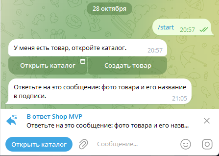
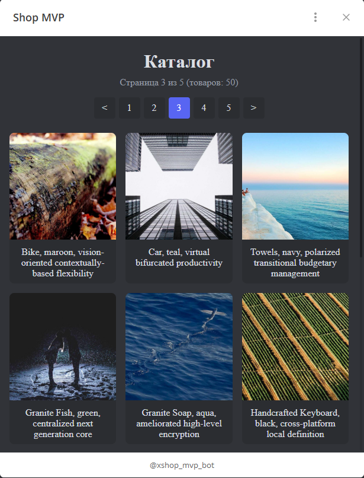

Live Demo: [Бот](https://t.me/xshop_mvp_bot) - [Каталог](https://shop-mvp.duckdns.org) - [Апи](https://shop-mvp.duckdns.org/api/docs)

MVP магазина товаров. Админ добавляет товары через тг бота. Каталог доступен через TMA в боте или на сайте по прямой ссылке.
<br>
Стек: Next.js, FastAPI, aiogram 3, PostgreSQL, MinIO, Caddy, docker.
<br>
Сервисы bot, backend, frontend не хранят состояние, могут работать в несколько реплик, по умолчанию две реплики на сервис.

Требования:
- Linux сервер с публичным IPv4
- Домен, указывающий на IP сервера
- Предустановленный git, docker, docker compose
- Открытые порты 80, 443. Получение сертификата через Caddy, выход в сеть
<br><br>


Установка:
```
git clone https://github.com/matchbull6/to_delete_test_repo.git shop-mvp
cd shop-mvp
cp .env.example .env
```
Заполнить .env, инструкция внутри
```
docker compose up -d --build
```
Вариативно, заполнение БД и хранилища 50 случайными товарами
```
docker compose run --rm seed
```

